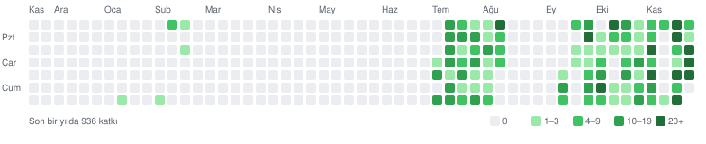

<h1 align="center">Hi, I'm Ferhan Burak Özkan 👋</h1>
<h3 align="center">Software Engineer · Mobile & Web · Network Security</h3>

  
  
  
  

## About me

- 🎓 Software Engineering (English) graduate, **Çankaya University**, 2025
- 📱 I build and ship end-to-end products: mobile apps on Google Play, production websites on custom domains, and the backends behind them
- 🛡️ Network security background: firewall, IDS/IPS and log analysis
- 🏆 **1st place** at Çankaya University's 18th R&D Project Market with **ScoliSense** (TÜBİTAK 2209-A, patent application filed)
- 🌍 Presented an AI-based smart energy management system (AEYS) at the **COP31 Startup Zone**, Antalya 2026
- 💼 Open to junior software, cloud and network engineering roles

## 🚀 Featured projects

| Project | What it is | Stack |
|---|---|---|
| **[TrackSnap](https://play.google.com/store/apps/details?id=com.ferhanburak.tracksnap)**   | GPS driving & route-recording app, live on Google Play. Background location tracking, App Check, closed testing with 20+ users | React Native · Expo · TypeScript · Firebase |
| **[ScoliSense](https://github.com/ScoliSense)** | Smart scoliosis brace: streams sensor data over BLE to a mobile app, with a web portal for clinicians | Flutter · Angular · Arduino · BLE |
| **[BALSA Dekor](https://balsadekor.com)** | Live furniture catalog with 50+ products and an admin panel, deployed with CI/CD | Next.js · Firebase · Vercel |
| **[Çeltikci Law Firm](https://www.celtikci.av.tr)**  | Responsive corporate website for a law firm, tested on every push via test-hub | Web |
| **[Mülakat Koçu](https://github.com/ferhanburak/mulakat-kocu)**  | Interview practice coach *(in progress)* | Mobile |
| **[Optik Sınav Koçu](https://github.com/ferhanburak/optik-sinav-kocu)**  | Optical-form exam practice coach *(in progress)* | Mobile |
| **[test-hub](https://github.com/ferhanburak/test-hub)** | One shared test-automation system for all my projects *(in progress)* | Vitest · Playwright · Maestro · Firebase Emulator |
| **[Turkish LLM Fine-Tuning](https://github.com/ferhanburak/Fine-Tuning-Turkish-Text-Generation)** | Fine-tuned open-source LLMs for Turkish with LoRA and 4-bit quantization | Python · Unsloth · PyTorch |
| **[Traffic Sign Classifier](https://github.com/ferhanburak/TrafficSignImageClassifaction)** | CNN reaching 98% test accuracy across 42 classes | Python · PyTorch |

## 💼 Experience

- **CBERNET** · Cyber Security & Network Engineer Intern *(Oct 2025 – Sep 2026)*: firewall, IDS/IPS, log analysis
- **Nokia** · Software Engineer Intern *(2025)*: AI chatbot, Selenium test automation, Agile
- **BOTAŞ** · Mobile Development Intern *(2023)*: Flutter inventory app, database synchronization

## 🛠️ Tech stack

   
   
   
  

## 📈 Contributions

<picture>
  <source media="(prefers-color-scheme: dark)" srcset="assets/contrib-dark.svg">
  
</picture>

<picture>
  <source media="(prefers-color-scheme: dark)" srcset="https://raw.githubusercontent.com/ferhanburak/ferhanburak/output/github-snake-dark.svg">
  
</picture>
